<div align="center">

# Ferrofluid AI Avatar

**A glossy black ferrofluid that listens, and reshapes itself into whatever your assistant is doing.**

Real-time, audio-reactive and embeddable. One HTML file, zero dependencies.

[](LICENSE)


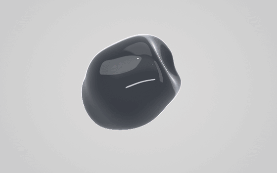

[**Live demo**](https://gfagherazzi.github.io/ferrofluid/) · [Integration example](https://gfagherazzi.github.io/ferrofluid/examples/integration.html) · [Quick start](#quick-start) · [API](#api-reference)

</div>

---

Ferrofluid AI Avatar renders a ferrofluid mass in the browser with WebGL2 (ray marching of signed distance fields) and drives it with the Web Audio API. It was designed as the visual "brain" of an AI assistant: the mass breathes with the microphone and morphs into a heart while chatting, a planet while searching the web, an open book while reading documents, or any icon you give it.

> [!NOTE]
> The on-screen interface is currently in **Italian**. Everything is documented here in English, with the Italian label next to each control (see the [UI glossary](#ui-glossary)). The JavaScript API, URL parameters and messages are in English.

## Contents

- [Features](#features)
- [Gallery](#gallery)
- [Quick start](#quick-start)
- [Using the interface](#using-the-interface)
- [Shapes](#shapes)
- [Color](#color)
- [Render styles (2D)](#render-styles-2d)
- [States](#states)
- [Configuration: tune, save, export](#configuration-tune-save-export)
- [Embedding in your app](#embedding-in-your-app)
- [API reference](#api-reference)
- [How it works](#how-it-works)
- [Browser support and performance](#browser-support-and-performance)
- [Troubleshooting](#troubleshooting)
- [Project structure](#project-structure)
- [Contributing](#contributing)
- [License](#license)
- [Acknowledgements](#acknowledgements)

## Features

- **Audio-reactive**: microphone, audio file or a built-in synthetic beat; automatic gain and noise-floor tracking, 32 log-spaced bands.
- **Seven shapes with fluid morphing**: free blob, heart, ringed planet, open book, photo, gear, plus any custom shape. Each one reacts to sound in its own way.
- **Any silhouette becomes fluid**: emoji, text, SVG path, SVG markup or image (PNG/JPG/WebP). Words can be spelled letter by letter and shapes played as sequences.
- **States vocabulary**: map your app's activities to choreographies (`thinking`, `searching`, `reading`, …) and trigger them with a single call.
- **Dynamic color**: per state, driven by the audio spectrum, or fixed; optional iridescent thin-film.
- **2D render styles**: flat fill, two-tone illustration, or outline only, on the same animated shape.
- **Ferrofluid spikes**: optional Rosensweig instability above a critical "field" threshold.
- **Design in the UI, ship as JSON**: tune everything in the panel, save states, export a config file, load it in production.
- **Embeddable**: iframe + `postMessage`, URL parameters, or a JavaScript API.
- **Zero dependencies, no build**: a single `index.html`; adaptive resolution; respects `prefers-reduced-motion`.

## Gallery

| Brain (idle) | Chat | Web |
|---|---|---|
| 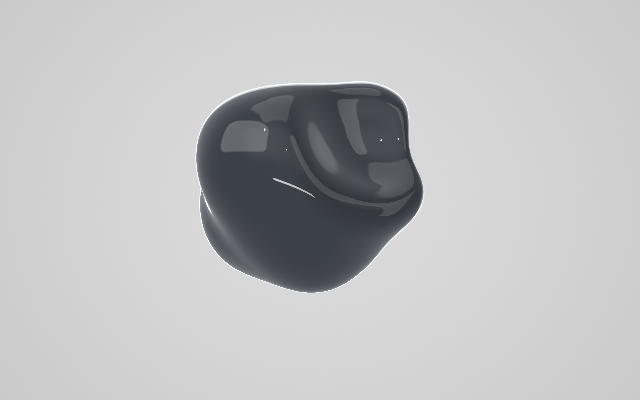 | 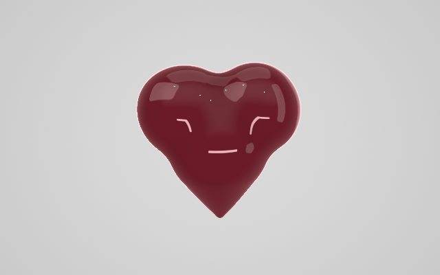 | 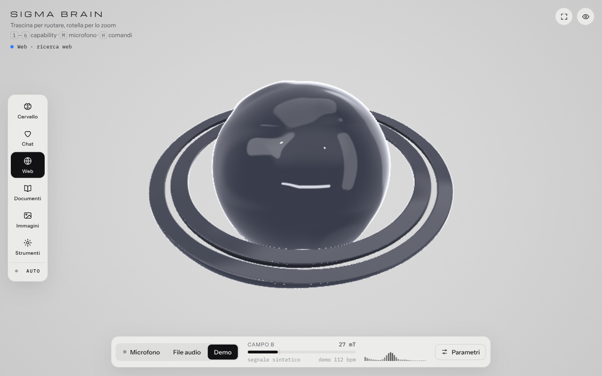 |

| Images | Tools | Iridescence |
|---|---|---|
| 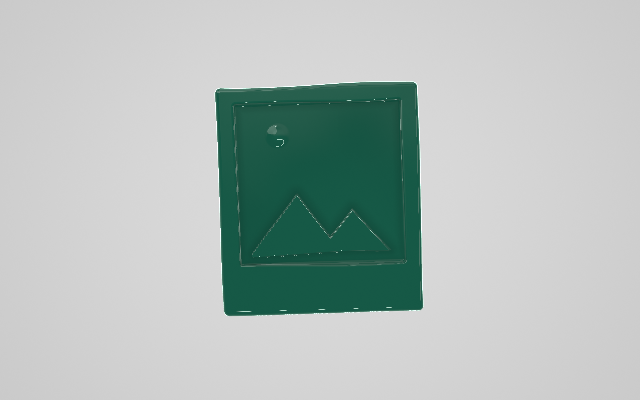 | 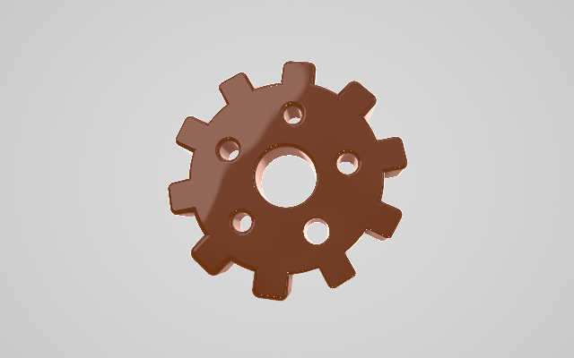 |  |

| Custom shape `setShape('AI')` | Custom shape `setShape('★')` | Custom shape from SVG |
|---|---|---|
| 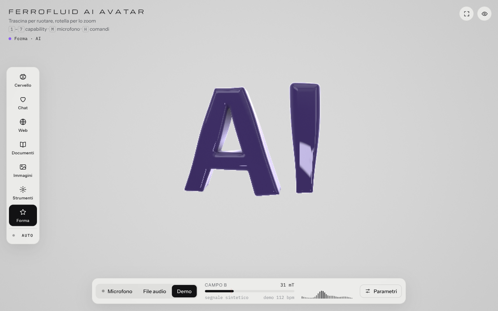 | 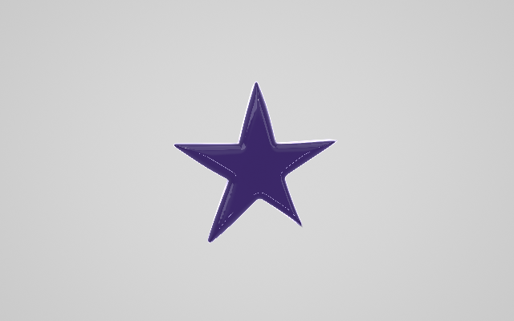 |  |

| Flat | Two-tone | Outline |
|---|---|---|
| 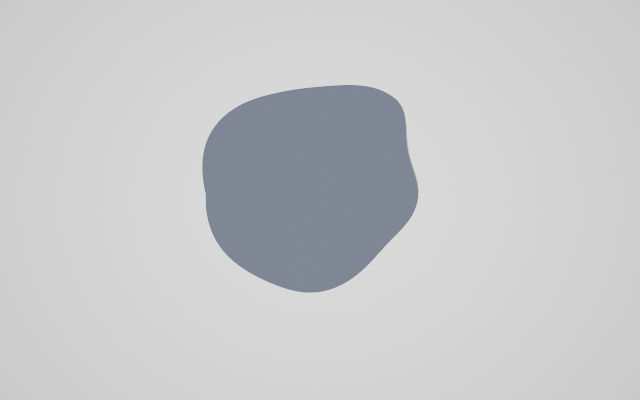 | 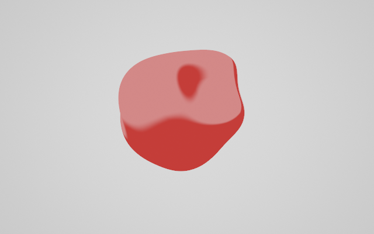 | 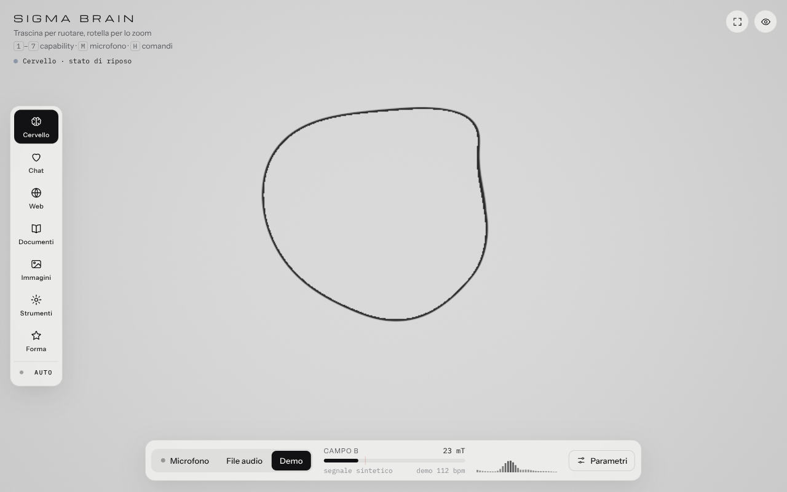 |

## Quick start

**Run it locally**

```bash
git clone https://github.com/gfagherazzi/ferrofluid.git
cd ferrofluid
python3 -m http.server 8000      # or: npx serve .
```

Open <http://localhost:8000>. The page starts in **Demo** mode (a synthetic 112 bpm beat); press the microphone button (*Microfono*) or <kbd>M</kbd> and allow access.

You can also double-click `index.html`: Chrome and Edge allow the microphone on `file://`, other browsers may not. Browsers only grant the microphone on `https://` or `localhost`.

**Publish it**

It is a static site, so any static host works:

- **GitHub Pages**: *Settings → Pages → Build and deployment → Deploy from a branch → `main` / `(root)`*. The page will be served at `https://<user>.github.io/<repo>/`.
- **Netlify, Vercel, Cloudflare Pages, S3, nginx**: upload the repository as is. There is no build step.

## Using the interface

### Audio sources

| Source | How |
|---|---|
| Microphone (*Microfono*) | button in the bottom dock or <kbd>M</kbd>; the browser asks for permission |
| Audio file (*File audio*) | button in the dock, or drag an mp3/wav/ogg/flac/m4a onto the page; <kbd>Space</kbd> pauses |
| Demo | synthetic kick, snare, hi-hat and pad; active on load; <kbd>D</kbd> |

The level is normalized with automatic gain and noise-floor subtraction, so the fluid reacts to a whisper as well as to loud music. *Sensibilità* (Sensitivity) scales it by hand. The dock shows the "B field" (the normalized level, displayed as 0–96 mT), the input level in dBFS and a 32-band spectrum.

### Keyboard and gestures

| Input | Action |
|---|---|
| drag | rotate the mass |
| mouse wheel / pinch | size |
| double-click | reset view and size |
| <kbd>1</kbd>–<kbd>7</kbd> | switch capability (7 = custom shape) |
| <kbd>A</kbd> | cycle through capabilities automatically |
| <kbd>M</kbd> / <kbd>D</kbd> | microphone / demo |
| <kbd>Space</kbd> | play/pause the audio file |
| <kbd>P</kbd> | parameters panel |
| <kbd>H</kbd> | hide/show all controls |
| <kbd>F</kbd> | fullscreen |

### Parameters

Open the panel with *Parametri* (<kbd>P</kbd>). Settings persist in the browser (`localStorage`); *Ripristina valori* (Reset values) restores the defaults.

| Group | Parameter | Default | Effect |
|---|---|---|---|
| Mass (*Massa*) | Size (*Dimensione*) | 100% | 50–180%, also with wheel and pinch |
| | Sensitivity (*Sensibilità*) | 1.00× | gain on the normalized level, 0.2–3× |
| | Deformation (*Deformazione*) | 65% | how far the lobes move away from the core (brain shape) |
| | Viscosity (*Viscosità*) | 50% | attack and release time; higher reacts and settles more slowly |
| | Auto-rotation (*Rotazione automatica*) | 30% | spin speed of the brain shape |
| Rosensweig instability | Magnetic spikes (*Punte magnetiche*) | 0% | spike height above the threshold; 0 keeps the surface smooth |
| | Critical threshold Bc (*Soglia critica Bc*) | 28 mT | level above which spikes appear |
| | Spike count (*Numero di punte*) | 200 | 80–420, on a spherical Fibonacci lattice |
| | Spike base (*Base delle punte*) | 90% | width of each spike's base |
| Color (*Colore*) | Source, fixed color, Intensity, Iridescence | Capability, 80%, 0% | see [Color](#color) |
| External shape (*Forma esterna*) | Thickness, Rounding, Engraving, Reactivity | 0.22, 60%, 56%, 60% | see [Custom shapes](#custom-shapes) |
| Studio | Render style (*Resa*), Outline (*Contorno*) | 3D, 0 px | see [Render styles](#render-styles-2d) |
| | Backdrop (*Fondale*) | Light | light or dark studio |
| | Quality (*Qualità*) | Auto | Auto adapts resolution to keep ~60 fps; High, Medium, Low are fixed |

The *Stati* (States) and *Configurazione* (Configuration) groups are described in [States](#states) and [Configuration](#configuration-tune-save-export).

### UI glossary

<details>
<summary>Italian labels → English</summary>

| Italian | English |
|---|---|
| Microfono · File audio · Demo | Microphone · Audio file · Demo |
| Campo B | B field (normalized level) |
| Parametri | Parameters |
| Cervello · Chat · Web · Documenti · Immagini · Strumenti · Forma | Brain · Chat · Web · Documents · Images · Tools · Shape |
| Massa · Dimensione · Sensibilità · Deformazione · Viscosità · Rotazione automatica | Mass · Size · Sensitivity · Deformation · Viscosity · Auto-rotation |
| Instabilità di Rosensweig · Punte magnetiche · Soglia critica Bc · Numero di punte · Base delle punte | Rosensweig instability · Magnetic spikes · Critical threshold Bc · Spike count · Spike base |
| Colore · Sorgente · Nero / Capability / Audio / Fisso · Colore fisso · Intensità · Iridescenza | Color · Source · Black / Capability / Audio / Fixed · Fixed color · Intensity · Iridescence |
| Forma esterna · Emoji, testo o path SVG · Applica · Carica… · Parola o sequenza · Avvia / Ferma | External shape · Emoji, text or SVG path · Apply · Load… · Word or sequence · Start / Stop |
| Spessore · Arrotondamento · Incisione · Reattività | Thickness · Rounding · Engraving · Reactivity |
| Studio · Resa: 3D / Piatto / Due toni / Contorno · Contorno · Fondale: Chiaro / Scuro · Qualità: Auto / Alta / Media / Bassa | Studio · Render style: 3D / Flat / Two-tone / Outline · Outline · Backdrop: Light / Dark · Quality: Auto / High / Medium / Low |
| Stati · × nessuno | States · × none |
| Configurazione · Salva stato · Esporta JSON · Copia JSON · Importa… · Elimina stato attivo | Configuration · Save state · Export JSON · Copy JSON · Import… · Delete active state |
| Ripristina valori | Reset values |

</details>

## Shapes

### Capabilities

Seven shapes, selectable from the left rail (a horizontal strip on phones), with <kbd>1</kbd>–<kbd>7</kbd> or through the API. *Auto* (<kbd>A</kbd>) cycles through them every 4.5 s.

| # | id | Shape | Audio reaction | Color (Capability mode) |
|---|---|---|---|---|
| 1 | `brain` | free blob (idle) | lobes, folds and ripples; spins | slate grey |
| 2 | `chat` | heart | beats with the bass | coral red |
| 3 | `web` | planet with two rings | relief rotates, pulses with the bass | blue |
| 4 | `docs` | open book | opens wider with the volume | amber |
| 5 | `images` | photo with sun and mountains in relief | sways slowly | teal |
| 6 | `tools` | gear | spins faster with the volume | orange |
| 7 | `custom` | any silhouette (see below) | pulses with the bass, thickness breathes with the volume | violet |

A morph takes 1.4 s: halfway through, the fluid "melts" and reforms into the new shape. Shapes other than the brain sway by ±16° instead of spinning, so they keep facing the viewer; you can still rotate them by dragging.

### Custom shapes

The `custom` shape takes its silhouette from an external graphic and turns it into a 3D fluid mass. It starts with the text AI.

| Source | Example |
|---|---|
| emoji or short text (up to 12 characters) | `🚀`, `★`, `AI`, `OK` |
| SVG path (`d` attribute) | `M12 2L2 22h20Z` |
| SVG markup | `<svg viewBox="0 0 100 100">…</svg>` |
| image (PNG, JPG, WebP) | file, URL or data URI; transparent images use alpha, opaque ones are read as a dark silhouette on a light background |

In the panel (*Forma esterna*): a text field with presets (AI ★ ⚡ 🚀 🧠 and a path), *Carica…* (Load…) for SVG or image files, and four sliders:

- **Thickness** (*Spessore*): extrusion depth.
- **Rounding** (*Arrotondamento*): how much the edges bulge. It is capped automatically by the thinnest strokes, so line icons do not vanish.
- **Engraving** (*Incisione*): darker areas of the image are carved into the front face, such as the eyes and mouth of 😄 or the details of a color logo. It has no effect on text, paths and single-color SVGs.
- **Reactivity** (*Reattività*): how much the shape pulses with the bass, breathes with the volume and ripples with the treble.

You can also drag an SVG or PNG onto the page.

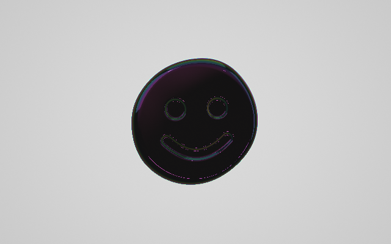

What works best: glyphs and icons with a distinctive silhouette (★ ⚡ 🚀 🔍 📄 💬 ❤, line icons such as Lucide or Feather, logos). Emoji that are colored discs (😄 🧠 🌍) rely on engraving to be recognizable and stay less legible than a clear silhouette.

Text sources (emoji, text, path, SVG) are remembered by the browser; images loaded from a file are kept as a data URI up to 400 KB.

### Words and sequences

*Parola o sequenza* (Word or sequence) in the same panel group: a single word (`AVATAR`) is spelled letter by letter and ends on the whole word; comma-separated items (`🔍, 📄, 💬`) loop until you press *Ferma* (Stop), pick another capability or load another shape. The pace follows animation time, so every morph completes before the next one starts.

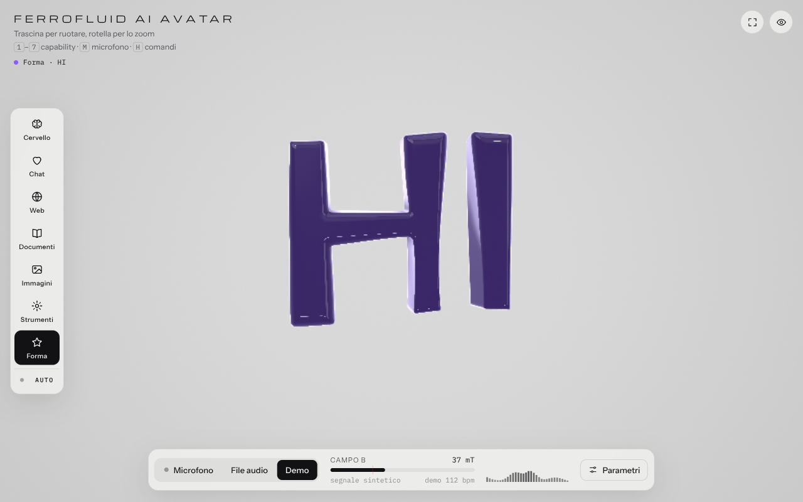

```js
ferrofluid.spell('AVATAR');                                  // A, V, A, T, A, R, then AVATAR
ferrofluid.spell('HELLO', { interval: 1, whole: false });    // letters only
ferrofluid.playSequence(['🔍', '📄', '💬'], { interval: 2 }); // loops (loop: true by default)
ferrofluid.playSequence('★, AI, ⚡', { loop: false });        // comma-separated string, played once
ferrofluid.playSequence(['web', '🔍']);                       // capability ids can be mixed in
ferrofluid.stopSequence();
```

## Color

Choose the tint source in *Colore → Sorgente*:

| Source | Behavior |
|---|---|
| Black (*Nero*) | black body with white reflections (the original look) |
| Capability | one color per shape (see the [capabilities table](#capabilities)); this is the default |
| Audio | hue follows the spectral centroid (bass → red, mids → yellow/green, treble → blue/violet); intensity rises with the volume |
| Fixed (*Fisso*) | the color from the picker or the API |

**Intensity** sets how much the tint enters the body and the reflections. **Iridescence** adds a thin-film sheen whose color depends on the viewing angle; it also works in Black mode. The dot next to the state name (top left) shows the current color.

## Render styles (2D)

The same shape and animation can be painted flat, for interfaces where a glossy 3D object does not fit: a chat avatar, a large icon, print graphics.

| Style | id | Look |
|---|---|---|
| 3D | `3d` | the glossy ferrofluid with reflections (default) |
| Flat (*Piatto*) | `flat` | uniform fill with an anti-aliased edge: black on a light backdrop, white on a dark one, or the current tint |
| Two-tone (*Due toni*) | `toon` | flat plus a lit side with a crisp terminator, illustration style; iridescence becomes a tint that follows the normal |
| Outline (*Contorno*) | `outline` | only the stroke around the silhouette |

**Outline** (0–12 px) adds a stroke to Flat and Two-tone too; the Outline style uses at least 2 px. The stroke is drawn outside the silhouette. Everything else (color, capabilities, custom shapes, sequences, spikes) works the same; a custom shape in Flat style is effectively an icon animated by sound.

Select it in *Studio → Resa*, with `?style=flat` in the URL, with `ferrofluid.setStyle('flat')` or with the `style` key of a state.

## States

States are the layer meant for your app. A **state** is a name (`searching`, `answering`, …) that bundles a shape or sequence, a color, parameters and a label. Your app only calls `ferrofluid.state('searching')`; the whole choreography lives in JSON.

The default vocabulary is defined in the `<script type="application/json" id="states-json">` block of `index.html` (edit it without touching the code): `idle`, `thinking`, `answering`, `searching`, `reading`, `looking`, `coding`, `greeting`, `error`, `done`. Try them from *Parametri → Stati*, or open `index.html#searching`.

A state definition (all keys optional):

| Key | Value |
|---|---|
| `capability` | a built-in shape: `brain`, `chat`, `web`, `docs`, `images`, `tools` |
| `shape` | a custom-shape source (emoji, text, path, SVG, image) |
| `sequence` | list of sources or capability ids, looped |
| `spell` | a word spelled letter by letter |
| `interval`, `loop`, `whole` | pace and repetition of sequences and words |
| `color` | `#rrggbb` (fixed color), or `capability`, `audio`, `none` |
| `intensity`, `iridescence` | tint and thin-film amount, 0–1 |
| `size`, `spikes`, `bc`, `density`, `width`, `morph`, `visc`, `spin` | mass and spike parameters (same ranges as the panel) |
| `thickness`, `rounding`, `engrave`, `react` | custom-shape parameters |
| `studio` | `light` or `dark` |
| `style`, `outline` | render style (`3d`, `flat`, `toon`, `outline`) and outline width in px |
| `label` | text shown next to the colored dot, top left |

If several of `spell`, `sequence`, `shape` and `capability` are present, the first one in this order wins. State parameters are overrides on top of the base settings: the next state (or `state(null)`) reverts them, and the browser always stores the base values.

```js
ferrofluid.state('searching');
ferrofluid.define('celebrating', { spell: 'WOW', color: '#ffd400', iridescence: 0.6, label: 'Hooray' });
ferrofluid.defineStates({ /* several at once */ });
await ferrofluid.loadStates('/states.json');   // from a JSON file
ferrofluid.state(null);                        // leave the active state
```

## Configuration: tune, save, export

The intended workflow: tune everything in the interface, save each combination as a state, export a JSON file, give it to the page that renders in production.

1. Adjust shape, color and parameters in the panel.
2. In *Parametri → Configurazione* type a name (e.g. `searching`) and press *Salva stato* (Save state). The current situation (shape or running sequence, color, all parameters) becomes a state definition.
3. Repeat for each state. *Elimina stato attivo* (Delete active state) removes the selected one.
4. *Esporta JSON* (Export JSON) downloads `ferrofluid-avatar.config.json`; *Copia JSON* copies it to the clipboard; *Importa…* (Import…) loads an exported file.

Load the file in production with any of:

```text
index.html?config=ferrofluid-avatar.config.json
```

```js
await ferrofluid.importConfig(json);   // object, or URL of a JSON file
iframe.contentWindow.postMessage({ type: 'ferrofluid:config', config: json }, '*');
```

<details>
<summary>Configuration file format</summary>

```jsonc
{
  "ferrofluidAvatar": 1,                 // format version
  "exported": "2026-11-11T10:00:00.000Z",
  "settings": {                          // base values of every parameter
    "sens": 1, "morph": 0.65, "visc": 0.5, "spin": 0.3,
    "spikes": 0, "bc": 0.35, "density": 200, "width": 0.9,
    "studio": "light", "quality": "auto", "size": 1,
    "colorMode": "capability", "color": "#2f7cff", "tintAmt": 0.8, "irid": 0,
    "style": "3d", "outline": 0,
    "shapeThick": 0.22, "shapeRound": 0.6, "shapeEngrave": 0.045, "shapeReact": 0.6
  },
  "capability": "brain",                 // shape shown when no state is active
  "shape": "AI",                         // current custom-shape source (string or object)
  "state": "idle",                       // state to apply after loading, or null
  "states": { "idle": { "capability": "brain", "label": "In ascolto" } }
}
```

Unknown keys and out-of-range values are ignored or clamped on import. Images loaded from a file are embedded as data URIs (up to 400 KB); SVG and paths as text.

</details>

## Embedding in your app

### 1. Add the iframe

```html
<iframe id="brain" src="https://<user>.github.io/<repo>/index.html?ui=off#idle"
        allow="microphone" title="Ferrofluid AI Avatar"
        style="width:100%;height:480px;border:0;background:#d7d7d5"></iframe>
```

`allow="microphone"` is required for the iframe to ask for microphone permission; without it, audio files and the demo still work.

### 2. URL parameters

| Parameter | Effect |
|---|---|
| `?ui=off` | hide every control, show only the fluid |
| `?studio=dark` / `light` | backdrop |
| `?style=flat` / `toon` / `outline` / `3d` | render style |
| `?config=file.json` | load an exported configuration (same-origin or CORS-enabled URL) |
| `#idle`, `#searching`, `#web`, `#custom`, … | initial state or capability |

They combine: `index.html?ui=off&studio=dark&style=flat&config=avatar.json#idle`.

### 3. Drive it from your app

Most apps need a single message, the **state**:

```html
<script>
  const frame = document.getElementById('brain');
  const ready = new Promise((ok) => frame.addEventListener('load', ok, { once: true }));
  async function send(msg) { await ready; frame.contentWindow.postMessage(msg, '*'); }

  // your app's events → fluid states
  const MAP = { idle: 'idle', thinking: 'thinking', reply: 'answering', web: 'searching',
                files: 'reading', vision: 'looking', code: 'coding', error: 'error', done: 'done' };
  function brain(event) { return send({ type: 'ferrofluid:state', name: MAP[event] || 'idle' }); }

  // or, without states: a shape, a color, a word
  send({ type: 'ferrofluid:shape', source: '🚀' });
  send({ type: 'ferrofluid:color', color: '#ff0066' });
  send({ type: 'ferrofluid:spell', word: 'HELLO' });
</script>
```

[`examples/integration.html`](examples/integration.html) is this page, ready to run: buttons for every state, a simulated conversation and a message log. Serve the repository and open `http://localhost:8000/examples/integration.html`.

Good to know:

- Messages sent before the iframe's `load` event are lost; wait for it as above.
- `'*'` as target origin is fine to start with; in production pass the fluid page's origin.
- The page accepts messages from **any** origin, by design, because it is meant to be embedded anywhere. Do not put secrets in states or configurations.
- To read the current configuration from outside, send `{ type: 'ferrofluid:export' }`; the page replies to the sender with `{ type: 'ferrofluid:config', config }`.
- Microphone permission can only be granted inside the iframe, when the user presses the microphone button. Show the controls with `{ type: 'ferrofluid:ui', visible: true }`.
- If your script runs inside `index.html` itself, call `window.ferrofluid` directly instead of posting messages.

## API reference

### JavaScript: `window.ferrofluid`

| Member | Returns | Description |
|---|---|---|
| `capabilities` | `string[]` | `['brain','chat','web','docs','images','tools','custom']` |
| `capability` | `string` | current shape (read-only) |
| `progress` | `number` | morph progress, 0–1; 1 when idle (read-only) |
| `setCapability(id)` | `boolean` | switch shape; `false` if unknown or already active; stops Auto |
| `auto(on)` | | start or stop cycling through capabilities |
| `colorModes` | `string[]` | `['none','capability','audio','fixed']` |
| `colorMode` | `string` | current color source (read-only) |
| `setColorMode(mode)` | `boolean` | change the color source |
| `setColor('#rrggbb')` | `boolean` | fixed color; switches to `fixed` |
| `setCapabilityColor(id, '#rrggbb')` | `boolean` | color used for a shape in `capability` mode |
| `setShape(source, options?)` | `Promise<boolean>` | load a custom shape and (by default) show it. `source`: a string (emoji/text, `M…` path, `<svg…>` markup, image URL or data URI) or an object `{ text }`, `{ path, viewBox?, fillRule? }`, `{ svg }`, `{ image: url \| File \| Blob \| HTMLImageElement, invert? }`, each with optional `name`. `options`: `{ thickness?, rounding?, activate?, instant?, silent? }` |
| `clearShape()` | `boolean` | back to `brain` |
| `shapeName` | `string \| null` | name of the loaded custom shape (read-only) |
| `playSequence(items, options?)` | `boolean` | loop a list of sources or capability ids (array or comma-separated string). `options`: `{ interval? = 1.8 s, loop? = true, shape? }` |
| `spell(word, options?)` | `boolean` | spell a word letter by letter, then the whole word. `options`: `{ interval? = 1.5 s, whole? = true, loop? = false, shape? }` |
| `stopSequence()` | | stop the running sequence |
| `sequence` | `object \| null` | `{ index, length, loop, interval }` of the running sequence (read-only) |
| `state(name \| null)` | `boolean` | apply a state, or leave the active one |
| `define(name, definition)` | `boolean` | add or replace a state |
| `defineStates(states)` | `boolean` | add or replace several states |
| `loadStates(url \| object)` | `Promise<boolean>` | load states from JSON |
| `removeState(name)` | `boolean` | delete a state |
| `saveState(name)` | `boolean` | save the current situation as a state (like the *Salva stato* button) |
| `states` | `object` | copy of the vocabulary (read-only) |
| `currentState` | `string \| null` | active state (read-only) |
| `exportConfig()` | `object` | full configuration, see [format](#configuration-tune-save-export) |
| `importConfig(object \| url)` | `Promise<boolean>` | load a configuration; `false` if it is not one |
| `ui(visible)` | | show or hide all controls |
| `styles` | `string[]` | `['3d','flat','toon','outline']` |
| `style` | `string` | current render style (read-only) |
| `setStyle(id)` | `boolean` | change the render style |

```js
// wait for a morph to finish
const morphDone = () => new Promise((ok) => {
  const tick = () => (ferrofluid.progress >= 1 ? ok() : requestAnimationFrame(tick));
  tick();
});
```

### `postMessage`

Send these to the iframe's `contentWindow`. They work cross-origin.

| `type` | Fields | Equivalent |
|---|---|---|
| `ferrofluid:state` | `name` (string or `null`) | `state(name)` |
| `ferrofluid:capability` | `name` | `setCapability(name)` |
| `ferrofluid:shape` | `source`, `options?` | `setShape(source, options)` |
| `ferrofluid:spell` | `word`, `options?` | `spell(word, options)` |
| `ferrofluid:sequence` | `items`, `options?` | `playSequence(items, options)` |
| `ferrofluid:stop` | | stop sequence and Auto |
| `ferrofluid:color` | `color` | `setColor(color)` |
| `ferrofluid:colorMode` | `mode` | `setColorMode(mode)` |
| `ferrofluid:style` | `style` | `setStyle(style)` |
| `ferrofluid:ui` | `visible` | `ui(visible)` |
| `ferrofluid:define` | `name` + `definition`, or `states` | `define()` / `defineStates()` |
| `ferrofluid:config` | `config` (object or URL) | `importConfig(config)` |
| `ferrofluid:export` | | replies `{ type: 'ferrofluid:config', config }` to the sender |

Message payloads must be serializable: pass a `File` or `Blob` to `setShape` from the same page instead.

## How it works

- **Rendering**: a single full-screen fragment shader ray-marches a signed distance field (up to 160 steps, with a bounding sphere to skip empty space). The brain shape is a core plus six orbiting lobes driven by the frequency bands, joined with a smooth minimum, with two subtracted spheres for the folds, slow noise and fast treble ripples on the surface.
- **Capabilities**: each shape is an SDF built from classic primitives (spheres, rounded cones and boxes, polar repetition for the gear teeth, extruded triangles for the mountains). Morphing linearly interpolates the two fields, which stays safe to ray-march; a burst of noise halfway gives the melt-and-reform effect.
- **Custom shapes**: the silhouette is drawn on a canvas, cropped and centered; an exact Euclidean distance transform runs inside and outside at 768×768, with sub-pixel edge distances taken from anti-aliased coverage; the field is downsampled to 384×384, smoothed with a ~2-texel Gaussian (which removes texel stair-stepping and keeps the field 1-Lipschitz) and uploaded as a two-channel half-float texture (signed distance, relative darkness). The shader extrudes it with rounded edges and carves the front face where the image is dark. Two textures alternate, so morphing between two custom shapes is smooth too.
- **Spikes**: cones on a spherical Fibonacci lattice, located in closed form, so the cost does not grow with the spike count.
- **Material**: near-black body with Fresnel reflections of an analytic studio environment (softboxes, a strip light, two point lights), 5-sample ambient occlusion and analytic edge anti-aliasing. 2D styles reuse the same field with flat or banded shading.
- **Audio**: `AnalyserNode` with a 2048-sample FFT; 32 logarithmic bands from 30 Hz to 14 kHz; RMS with adaptive noise floor and automatic gain; separate attack and release envelopes (the viscosity); spectral centroid for the Audio color mode.
- **Interface**: vanilla HTML, CSS and JavaScript; color tokens for the light and dark studio; responsive down to 390 px; settings in `localStorage`.

To add a built-in shape: write an `sdName(vec3 p)` function in the shader, add a case to `shapeD()`, add an entry to `CAPS` (with `ext`, the shape's maximum extent, used for the bounding sphere) and an icon to `ICONS`.

## Browser support and performance

- Requires **WebGL2**: current Chrome, Edge, Firefox and Safari 15+. Without it the page shows a notice.
- In *Auto* quality the render buffer scales between 40% and 100% of the device pixel ratio (capped at 1.5×) based on frame time; *High* renders at up to 2×.
- Animation time is capped at 0.1 s per frame, so on very slow machines morphs slow down instead of skipping.
- Custom shapes cost a little more than the built-in ones (one texture lookup per ray-marching step).
- Touch: drag to rotate, pinch to resize; the capability rail scrolls horizontally on phones.
- Honors `prefers-reduced-motion`: no auto-rotation, slower fluid, no UI animations.

## Troubleshooting

| Symptom | Cause and fix |
|---|---|
| The microphone does not start | Serve over `https://` or `localhost`; inside an iframe add `allow="microphone"`; sandboxed previews block it, so open `index.html` directly |
| "Il browser blocca la lettura di questa immagine (CORS)" | The image comes from another domain without CORS headers: download it and load it as a file, or use a data URI |
| An emoji is an unrecognizable disc | Its silhouette is a disc: raise *Engraving*, or pick a glyph with a distinctive outline (★ ⚡ 🚀 🔍 📄) |
| Choppy animation | Set quality to *Auto*, *Medium* or *Low* |
| "WEBGL2 NON DISPONIBILE" (WebGL2 not available) | Update the browser or enable hardware acceleration |
| `postMessage` does nothing | Sent before the iframe's `load` event, or a misspelled `type` (see the [message table](#postmessage)) |
| Settings change on their own | The browser remembers the last settings: use *Ripristina valori* (Reset values), or always pass a `?config=` |

## Project structure

```text
.
├── index.html              # the whole app: styles, GLSL shader, audio, UI, API
├── examples/
│   └── integration.html    # host page: iframe + postMessage
├── docs/
│   ├── demo.gif            # README animation
│   └── screenshots/        # README images
├── .nojekyll              # serve the files as is on GitHub Pages
├── LICENSE                 # Apache License 2.0
├── NOTICE
└── README.md
```

There is no build step and no package manager: edit `index.html` and reload.

## Contributing

Issues and pull requests are welcome.

- Keep it dependency-free and contained in `index.html`; new examples go in `examples/`.
- Test in at least one Chromium-based browser and Firefox (and Safari if you can), with both light and dark backdrops and on a phone-sized viewport.
- New built-in shapes: follow the steps at the end of [How it works](#how-it-works) and add a screenshot.
- Describe visual changes with a screenshot or short clip in the pull request.

## License

Copyright 2026 Giovanni Fagherazzi.

Licensed under the [Apache License, Version 2.0](LICENSE). See [NOTICE](NOTICE).

## Acknowledgements

- Signed distance primitives and smooth minimum after [Inigo Quilez](https://iquilezles.org/articles/distfunctions/).
- Spherical Fibonacci lattice lookup: B. Keinert et al., *Spherical Fibonacci Mapping*, ACM TOG 2015.
- Distance transform: P. Felzenszwalb and D. Huttenlocher, *Distance Transforms of Sampled Functions*, Theory of Computing 2012.
- The spikes mimic the Rosensweig (normal-field) instability of real ferrofluids.
- Fonts: [Michroma](https://fonts.google.com/specimen/Michroma), [Instrument Sans](https://fonts.google.com/specimen/Instrument+Sans) and [IBM Plex Mono](https://fonts.google.com/specimen/IBM+Plex+Mono), served by Google Fonts.
