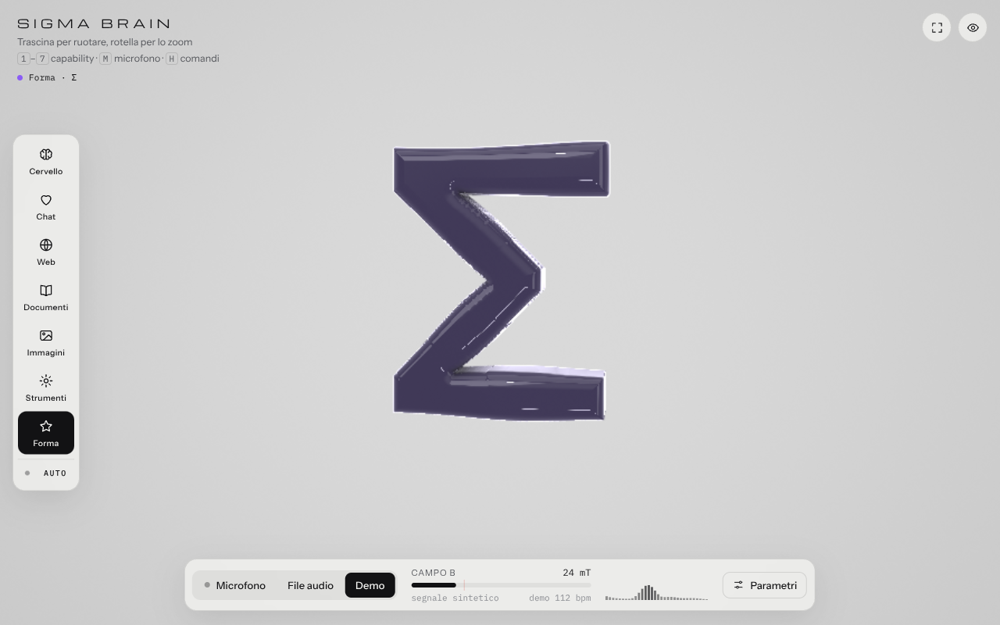
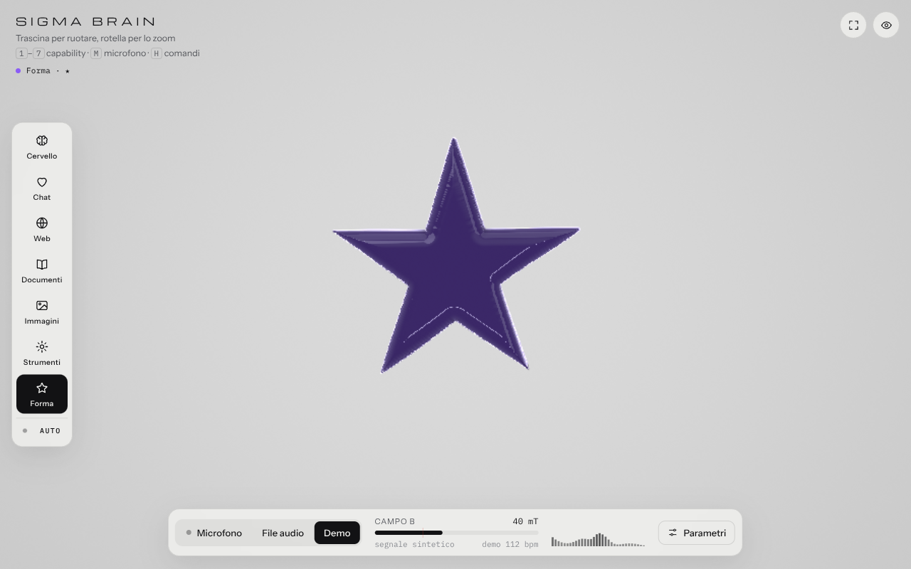
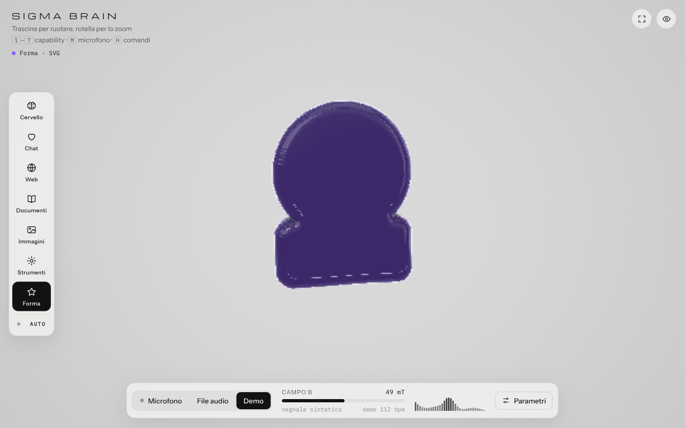

# Sigma Brain

Una massa di ferrofluido nero e lucido, resa in tempo reale nel browser, che si deforma con l'audio del microfono e cambia forma a seconda della *capability* in uso: cuore, pianeta, libro, foto, ingranaggio. Pensata come rappresentazione visiva di un assistente che "pensa" in modi diversi.

Un solo file, `index.html`, senza dipendenze né build: WebGL2 + GLSL (ray marching di campi di distanza), Web Audio API per l'analisi del suono.

| Cervello (riposo) | Chat | Web |
|---|---|---|
|  |  |  |

| Immagini | Strumenti | Iridescenza |
|---|---|---|
|  |  |  |

| Forma esterna: `setShape('Σ')` | Forma esterna: `setShape('★')` | Forma esterna: SVG |
|---|---|---|
|  |  |  |

## Indice

- [Avvio](#avvio)
- [Sorgenti audio](#sorgenti-audio)
- [Capability](#capability)
- [Forma esterna](#forma-esterna)
- [Vocabolario di stati](#vocabolario-di-stati)
- [Configurazione: prova, salva, esporta](#configurazione-prova-salva-esporta)
- [Colore](#colore)
- [Parametri](#parametri)
- [Comandi](#comandi)
- [API JavaScript](#api-javascript)
- [Integrazione in un'app](#integrazione-in-unapp)
- [Come funziona](#come-funziona)
- [Prestazioni e compatibilità](#prestazioni-e-compatibilità)
- [Struttura del progetto](#struttura-del-progetto)

## Avvio

Apri `index.html` in Chrome, Edge, Firefox o Safari. Parte in modalità **Demo** (batteria sintetica a 112 bpm); premi **Microfono** o il tasto `M` e concedi il permesso.

Il microfono richiede un contesto sicuro. Chrome lo accetta anche da `file://`; se il browser rifiuta, servi la cartella in locale:

```bash
python3 -m http.server 8000      # oppure: npx serve .
```

e apri `http://localhost:8000`. Online va pubblicata su `https` (GitHub Pages, Netlify, Vercel: è un file statico).

## Sorgenti audio

| Sorgente | Come |
|---|---|
| Microfono | pulsante **Microfono** o tasto `M`; il browser chiede il permesso |
| File audio | pulsante **File audio**, oppure trascina un mp3/wav/ogg/flac/m4a sulla pagina; `Spazio` mette in pausa |
| Demo | batteria sintetica, attiva all'apertura; tasto `D` |

Il livello è normalizzato con guadagno automatico e sottrazione del rumore di fondo, quindi reagisce sia a una voce sussurrata sia alla musica alta. Il cursore **Sensibilità** lo scala a mano. Il dock mostra il "campo B" (livello normalizzato, 0–96 mT), i dBFS in ingresso e lo spettro a 32 bande.

## Capability

Sei stati, selezionabili dalla barra a sinistra (sul telefono: striscia sotto l'intestazione), con i tasti `1`–`6` o via API. **Auto** (tasto `A`) li alterna ogni 4,5 secondi.

| # | id | Forma | Reazione all'audio | Colore (modalità Capability) |
|---|---|---|---|---|
| 1 | `brain` | massa libera (riposo) | lobi, pieghe e increspature; ruota su sé stessa | grigio ardesia |
| 2 | `chat` | cuore | batte con i bassi | rosso corallo |
| 3 | `web` | pianeta con due anelli | rilievi che ruotano, pulsa con i bassi | blu |
| 4 | `docs` | libro aperto | si apre di più con il volume | ambra |
| 5 | `images` | foto con sole e montagne in rilievo | oscilla lentamente | verde acqua |
| 6 | `tools` | ingranaggio | gira più veloce con il volume | arancio |
| 7 | `custom` | **forma esterna**: qualsiasi silhouette (vedi sotto) | oscilla lentamente, increspature | viola |

La transizione tra due forme dura 1,4 s: il fluido si "scioglie" a metà strada e si ricompone nella forma nuova. Nelle forme il corpo resta vivo (onde e increspature attenuate) e oscilla di ±16° invece di ruotare, così resta rivolto verso chi guarda. Trascinando si ruota comunque a mano; doppio clic riporta la vista al centro.

## Forma esterna

Lo stato **Forma** (tasto `7`) prende la silhouette da un riferimento grafico fornito dall'esterno e la trasforma in una massa liquida 3D. All'apertura contiene la Σ di Sigma.

Sorgenti accettate:

| Sorgente | Esempio |
|---|---|
| emoji o testo breve (max 12 caratteri) | `🚀`, `Σ`, `★`, `AI` |
| path SVG (attributo `d`) | `M12 2L2 22h20Z` |
| SVG completo | `<svg viewBox="0 0 100 100">…</svg>` |
| immagine PNG/JPG/WebP | file, URL o data URI; con trasparenza usa l'alpha, altrimenti legge la silhouette scura su fondo chiaro |

Dal pannello **Parametri → Forma esterna**: campo di testo con preset (Σ ★ ⚡ 🚀 🧠 e un path), pulsante **Carica…** per file SVG o immagine, slider **Spessore** (profondità dell'estrusione), **Arrotondamento** (quanto i bordi si gonfiano; limitato automaticamente dallo spessore dei tratti più sottili, così le icone a linea non spariscono) e **Incisione** (le zone più scure dell'immagine vengono incise sulla faccia frontale: gli occhi e la bocca di 😄, le pieghe di 🧠, i dettagli di un logo a colori; non agisce su testo, path e SVG monocromatici). Si può anche trascinare un SVG o un PNG sulla pagina.

Cosa funziona meglio: glifi e icone con una silhouette riconoscibile (★ ⚡ 🚀 🔍 📄 💬 ❤, icone a linea tipo Lucide/Feather, loghi). Le emoji che sono dischi colorati (😄 🧠 🌍) si riconoscono grazie all'incisione dei dettagli scuri, ma restano meno leggibili di una silhouette.

Come funziona: la silhouette viene disegnata su un canvas, ritagliata e centrata; a risoluzione 768×768 si calcola la trasformata di distanza esatta (Felzenszwalb–Huttenlocher) dentro e fuori, corretta sul bordo con la copertura anti-aliasata del pixel; il campo viene ridotto a 384×384 con media e una sfocatura leggera (che toglie la scalettatura dei texel senza spostare il bordo e mantiene il campo 1-Lipschitz) e caricato come texture half-float a due canali: distanza con segno e scurezza relativa alla luminanza media della silhouette. Lo shader legge il campo 2D, lo estrude in profondità con bordi arrotondati, arretra la faccia frontale dove l'immagine è scura e applica le stesse onde e increspature delle altre forme. Due texture si alternano, quindi anche il passaggio da una forma esterna all'altra è una transizione fluida.

Le sorgenti testuali (emoji, path, SVG) restano salvate nel browser e vengono ricaricate all'apertura; le immagini da file vengono conservate come data URI fino a 400 KB, oltre no.

### Sequenze e parole

Nello stesso gruppo del pannello, **Parola o sequenza**: una parola (`SIGMA`) viene scritta lettera per lettera e chiusa con la parola intera; più voci separate da virgola (`🔍, 📄, 💬`) si alternano in ciclo finché non si preme **Ferma**, si sceglie un'altra capability o si carica un'altra forma. Il ritmo segue il tempo dell'animazione, quindi ogni transizione finisce prima che parta la successiva.

Via API:

```js
sigmaBrain.spell('SIGMA');                                   // S, I, G, M, A, poi SIGMA
sigmaBrain.spell('CIAO', { interval: 1, whole: false });     // solo le lettere
sigmaBrain.playSequence(['🔍', '📄', '💬'], { interval: 2 }); // in ciclo (loop: true di default)
sigmaBrain.playSequence('★, Σ, ⚡', { loop: false });         // stringa separata da virgole, una volta sola
sigmaBrain.stopSequence();
sigmaBrain.sequence;   // { index, length, loop, interval } oppure null
```

Ogni voce accetta le stesse sorgenti di `setShape` (emoji, testo, path, SVG, immagine) oppure l'id di una capability (`'web'`, `'chat'`, …), così una sequenza può alternare forme matematiche e forme esterne.

## Vocabolario di stati

Il livello pensato per l'app: uno **stato** è un nome (`searching`, `answering`, …) che raggruppa forma o sequenza, colore, parametri ed etichetta. Dall'app si chiama solo `sigmaBrain.state('searching')`; tutta la coreografia sta in un JSON.

Il vocabolario di default è nel blocco `<script type="application/json" id="states-json">` della pagina (modificabile senza toccare il codice) e comprende `idle`, `thinking`, `answering`, `searching`, `reading`, `looking`, `coding`, `greeting`, `error`, `done`. Nel pannello **Parametri → Stati** ci sono i pulsanti per provarli; `#searching` nell'URL apre direttamente in quello stato.

Definizione di uno stato (tutte le chiavi sono facoltative):

| Chiave | Valore |
|---|---|
| `capability` | id di una forma matematica: `brain`, `chat`, `web`, `docs`, `images`, `tools` |
| `shape` | sorgente di forma esterna (emoji, testo, path, SVG, immagine) |
| `sequence` | lista di sorgenti o id di capability, alternati in ciclo |
| `spell` | parola scritta lettera per lettera |
| `interval`, `loop`, `whole` | ritmo e ripetizione di sequenze e parole |
| `color` | `#rrggbb` (colore fisso), oppure `capability`, `audio`, `none` |
| `intensity`, `iridescence` | tinta e pellicola iridescente, 0–1 |
| `size`, `spikes`, `bc`, `density`, `width`, `morph`, `visc`, `spin` | parametri della massa e delle punte |
| `thickness`, `rounding`, `engrave` | parametri della forma esterna |
| `studio` | `light` o `dark` |
| `label` | testo mostrato accanto al pallino colorato in alto a sinistra |

Se `spell`, `sequence`, `shape` e `capability` sono presenti insieme, vale il primo in quest'ordine. I parametri di uno stato sono sovrapposizioni ai valori base: lo stato successivo (o `state(null)`) li annulla, e il salvataggio nel browser conserva sempre i valori base.

```js
sigmaBrain.state('searching');
sigmaBrain.define('celebrating', { spell: 'WOW', color: '#ffd400', iridescence: 0.6, label: 'Evviva' });
sigmaBrain.defineStates({ ... });          // più stati in una volta
await sigmaBrain.loadStates('/states.json'); // da un file JSON
sigmaBrain.state(null);                      // annulla lo stato attivo
sigmaBrain.currentState;                     // 'searching' | null
sigmaBrain.states;                           // copia del vocabolario
```

## Configurazione: prova, salva, esporta

Il flusso di lavoro pensato per chi integra: si regola tutto dall'interfaccia, si salva ogni combinazione come stato, si esporta un JSON e lo si dà alla pagina che renderizza.

1. Regola forma, colore e parametri dal pannello.
2. In **Parametri → Configurazione** scrivi un nome (per esempio `searching`) e premi **Salva stato**: la situazione corrente (forma o sequenza in corso, colore, tutti i parametri) diventa una definizione di stato.
3. Ripeti per ogni stato. **Elimina stato attivo** toglie quello selezionato.
4. **Esporta JSON** scarica `sigma-brain.config.json`; **Copia JSON** lo mette negli appunti; **Importa…** ricarica un file esportato.

Il JSON contiene `settings` (i valori base di tutti i parametri), `capability` e `shape` correnti, lo `state` attivo e `states` (il vocabolario). Per caricarlo nella pagina:

```js
sigmaBrain.importConfig(json);                 // oggetto o URL di un file JSON
sigmaBrain.exportConfig();                     // → oggetto
sigmaBrain.saveState('searching');             // come il pulsante Salva stato
sigmaBrain.removeState('searching');
```

```
index.html?config=sigma-brain.config.json      // all'apertura
```

```js
// da una pagina che la incorpora
w.postMessage({ type: 'sigmabrain:config', config: json }, '*');
w.postMessage({ type: 'sigmabrain:export' }, '*');   // risponde con { type: 'sigmabrain:config', config }
```

Le forme da file immagine finiscono nell'export come data URI (fino a 400 KB); SVG e path come testo.

## Colore

Sorgente della tinta, nel pannello **Parametri → Colore**:

| Sorgente | Comportamento |
|---|---|
| Nero | materiale nero con riflessi bianchi (il riferimento originale) |
| Capability | un colore per stato (tabella sopra); è il default |
| Audio | la tonalità segue il baricentro spettrale (gravi → rosso, medi → giallo/verde, acuti → blu/viola) e l'intensità sale col volume |
| Fisso | il colore scelto nel selettore o passato via API |

**Intensità** regola quanto la tinta entra nel corpo e nei riflessi. **Iridescenza** aggiunge una pellicola sottile che cambia colore con l'angolo di vista; funziona anche in modalità Nero. Il pallino accanto al nome dello stato, in alto a sinistra, mostra il colore corrente.

## Parametri

Pannello **Parametri** (tasto `P`). Tutte le impostazioni restano salvate nel browser; **Ripristina valori** riporta ai default.

**Massa**
- *Dimensione* (50–180%): sincronizzata con rotella e pizzico.
- *Sensibilità* (0,2–3×): guadagno sul livello normalizzato.
- *Deformazione*: quanto i lobi si allontanano dal nucleo nello stato Cervello.
- *Viscosità*: velocità di attacco e rilascio; più alta, più il liquido reagisce e si calma lentamente.
- *Rotazione automatica*: velocità di rotazione dello stato Cervello.

**Instabilità di Rosensweig**
Sopra una soglia critica Bc la superficie di un ferrofluido reale si rompe in punte; qui il "campo" è il livello audio. *Punte magnetiche* è a zero di default (massa liscia); alzalo e regola *Soglia critica Bc*, *Numero di punte* e *Base delle punte*. Le punte sono disposte su un reticolo di Fibonacci sferico e ciascuna risponde a una banda dello spettro.

**Colore**: vedi sopra.

**Studio**: fondale chiaro o scuro; qualità di rendering (*Auto* adatta la risoluzione per tenere 60 fps, *Alta* usa fino a 2× il device pixel ratio).

## Comandi

| Tasto / gesto | Azione |
|---|---|
| trascina | ruota la massa |
| rotella / pizzico | dimensione |
| doppio clic | riporta vista e dimensione ai default |
| `1`–`7` | capability (7 = forma esterna) |
| `A` | sequenza automatica delle capability |
| `M` / `D` | microfono / demo |
| `Spazio` | pausa e riproduzione del file audio |
| `P` | pannello parametri |
| `H` | nasconde o mostra i comandi |
| `F` | schermo intero |

## API JavaScript

La pagina espone `window.sigmaBrain` (alias `window.ferrofluido`, mantenuto per compatibilità).

| Membro | Tipo | Descrizione |
|---|---|---|
| `capabilities` | `string[]` | `['brain','chat','web','docs','images','tools','custom']` |
| `capability` | `string` (sola lettura) | stato corrente |
| `progress` | `number` (sola lettura) | avanzamento della transizione di forma, 0..1 (1 = ferma) |
| `setCapability(id)` | `→ boolean` | cambia stato; `false` se l'id non esiste o è già attivo. Spegne Auto |
| `auto(on)` | | attiva o spegne la sequenza automatica |
| `colorModes` | `string[]` | `['none','capability','audio','fixed']` |
| `colorMode` | `string` (sola lettura) | sorgente del colore corrente |
| `setColorMode(mode)` | `→ boolean` | cambia sorgente del colore |
| `setColor('#rrggbb')` | `→ boolean` | imposta un colore fisso e passa alla sorgente `fixed` |
| `setCapabilityColor(id, '#rrggbb')` | `→ boolean` | cambia il colore associato a uno stato (sorgente `capability`) |
| `setShape(source, options?)` | `→ Promise<boolean>` | carica una forma esterna e (di default) passa allo stato `custom`. `source`: stringa (emoji/testo, path `M…`, markup `<svg…>`, URL o data URI di immagine) oppure oggetto `{ text }`, `{ path, viewBox?, fillRule? }`, `{ svg }`, `{ image: url \| File \| Blob \| HTMLImageElement, invert? }`, tutti con `name?`. `options`: `{ thickness?: 0.06–0.5, rounding?: 0–1, activate?: boolean, instant?: boolean, silent?: boolean }` |
| `clearShape()` | `→ boolean` | torna allo stato `brain` |
| `shapeName` | `string \| null` (sola lettura) | nome della forma esterna caricata |
| `playSequence(items, options?)` | `→ boolean` | alterna una lista di sorgenti (array, o stringa separata da virgole). `options`: `{ interval?: secondi (default 1,8), loop?: boolean (default true), shape?: opzioni di setShape }` |
| `spell(word, options?)` | `→ boolean` | scrive una parola lettera per lettera, poi la parola intera. `options`: `{ interval?: secondi (default 1,5), whole?: boolean (default true), loop?: boolean (default false), shape? }` |
| `stopSequence()` | | ferma la sequenza in corso |
| `sequence` | `object \| null` (sola lettura) | `{ index, length, loop, interval }` della sequenza in corso |
| `state(name \| null)` | `→ boolean` | applica uno stato del vocabolario, o annulla quello attivo |
| `define(name, def)`, `defineStates(obj)`, `loadStates(url \| obj)` | | definisce stati (vedi [Vocabolario di stati](#vocabolario-di-stati)) |
| `removeState(name)`, `saveState(name)` | `→ boolean` | elimina uno stato; salva la situazione corrente come stato |
| `states`, `currentState` | (sola lettura) | copia del vocabolario; nome dello stato attivo o `null` |
| `exportConfig()`, `importConfig(obj \| url)` | | esporta e importa la configurazione completa (vedi [Configurazione](#configurazione-prova-salva-esporta)) |

Esempi:

```js
sigmaBrain.setShape('🚀');                                 // emoji
sigmaBrain.setShape('M12 2L2 22h20Z');                     // path SVG
sigmaBrain.setShape({ svg: svgMarkup, name: 'logo' });    // SVG completo
sigmaBrain.setShape({ image: '/icons/bolt.png' }, { thickness: 0.3 });
sigmaBrain.setShape(fileInput.files[0]);                   // File da un <input type="file">
sigmaBrain.setShape('★', { activate: false });             // precarica senza cambiare stato

sigmaBrain.setCapability('web');          // il fluido diventa un pianeta
sigmaBrain.setColor('#ff0066');           // tinta fissa magenta
sigmaBrain.setColorMode('audio');         // il colore segue il suono
sigmaBrain.setCapabilityColor('chat', '#ff2d95');
sigmaBrain.auto(true);

// attendere la fine di una transizione
const waitIdle = () => new Promise((ok) => {
  const tick = () => (sigmaBrain.progress >= 1 ? ok() : requestAnimationFrame(tick));
  tick();
});
```

**Stato iniziale dall'URL**: `index.html#chat` apre direttamente in quello stato (nessuna transizione).

**Da una pagina che la incorpora in un `<iframe>`** (funziona anche cross-origin):

```js
const w = iframe.contentWindow;
w.postMessage({ type: 'sigmabrain:capability', name: 'docs' }, '*');
w.postMessage({ type: 'sigmabrain:color', color: '#ff0066' }, '*');
w.postMessage({ type: 'sigmabrain:colorMode', mode: 'audio' }, '*');
w.postMessage({ type: 'sigmabrain:shape', source: '🚀', options: { thickness: 0.3 } }, '*');
w.postMessage({ type: 'sigmabrain:shape', source: { svg: svgMarkup, name: 'logo' } }, '*');
w.postMessage({ type: 'sigmabrain:spell', word: 'SIGMA', options: { interval: 1.2 } }, '*');
w.postMessage({ type: 'sigmabrain:sequence', items: ['🔍', '📄', '💬'], options: { interval: 2 } }, '*');
w.postMessage({ type: 'sigmabrain:stop' }, '*');
w.postMessage({ type: 'sigmabrain:state', name: 'searching' }, '*');
w.postMessage({ type: 'sigmabrain:define', name: 'celebrating', definition: { spell: 'WOW' } }, '*');
w.postMessage({ type: 'sigmabrain:define', states: { ... } }, '*');
```

Per `postMessage` la sorgente deve essere serializzabile: testo, path, markup SVG, URL o data URI; un `File` o `Blob` va passato direttamente a `setShape` dalla stessa pagina.

## Integrazione in un'app

Esempio minimo: il fluido in un `<iframe>` e una funzione che lo aggiorna quando l'assistente cambia attività.

```html
<iframe id="brain" src="sigma-brain/index.html#brain"
        allow="microphone" style="width:100%;height:480px;border:0"></iframe>
<script>
  const brain = document.getElementById('brain').contentWindow;
  const STATE = { thinking: 'brain', answering: 'chat', searching: 'web',
                  reading: 'docs', looking: 'images', coding: 'tools' };
  function onAssistantActivity(activity) {
    brain.postMessage({ type: 'sigmabrain:capability', name: STATE[activity] || 'brain' }, '*');
  }
</script>
```

Note:
- l'attributo `allow="microphone"` serve perché l'iframe possa chiedere il permesso; senza, resta disponibile l'audio da file o la demo;
- per nascondere l'interfaccia e lasciare solo il fluido, premi `H` oppure aggiungi la classe `ui-off` a `<body>` dalla pagina stessa;
- il fondale segue il parametro **Studio** (chiaro/scuro); i colori dell'interfaccia sono token CSS in cima al file (`:root` e `body[data-studio="dark"]`).

## Come funziona

- **Forma**: tutto è un campo di distanza con segno (SDF) valutato per pixel in un fragment shader (ray marching, 160 passi max, bounding sphere per saltare il vuoto). Lo stato Cervello è un nucleo più sei lobi che orbitano guidati dalle bande di frequenza, uniti con *smooth minimum*, due sfere sottratte che creano le pieghe, un rumore lento e increspature veloci (acuti) sulla superficie.
- **Capability**: ogni forma è un SDF scritto con primitive classiche (sfere, coni arrotondati, box arrotondati, ripetizione polare per i denti dell'ingranaggio, triangoli estrusi per le montagne). Il passaggio da una forma all'altra è un'interpolazione lineare tra i due campi, che il ray marching attraversa senza problemi perché resta 1-Lipschitz; un picco di rumore a metà transizione dà l'effetto "si scioglie e si ricompone".
- **Forma esterna**: silhouette → copertura anti-aliasata 384×384 → trasformata di distanza esatta, con la distanza sul bordo ricavata dalla copertura → texture R16F letta con `textureLod` nello shader ed estrusa con bordi arrotondati (somma di Minkowski tra la forma ristretta e una sfera). Fuori dal quadrato della texture il campo continua con la distanza dal quadrato, così il ray marching resta corretto.
- **Punte**: coni su un reticolo di Fibonacci sferico, valutato in forma chiusa (inverse mapping di Keinert et al.), quindi il costo non cresce con il numero di punte.
- **Materiale**: superficie quasi nera con riflessi di Fresnel di un ambiente da studio calcolato analiticamente (tre softbox, una striscia, due punti luce, un pannello frontale), occlusione ambientale a 5 campioni, bordo anti-aliasato per copertura stimata del pixel. La tinta entra nel colore del corpo, in un bordo colorato verso la silhouette e, in parte, nei riflessi; l'iridescenza è una pellicola sottile il cui colore dipende dall'angolo di vista.
- **Audio**: `AnalyserNode` a 2048 campioni; 32 bande logaritmiche da 30 Hz a 14 kHz; RMS con pavimento di rumore adattivo e guadagno automatico; inviluppi con attacco e rilascio separati (la viscosità); baricentro spettrale per la tonalità in modalità Audio.
- **Interfaccia**: HTML/CSS vanilla, token di colore per lo studio chiaro e scuro, layout adattivo fino a 390 px di larghezza, impostazioni in `localStorage`.

Per aggiungere una forma: una funzione `sdNome(vec3 p)` nello shader, un caso in `shapeD()`, una riga in `CAPS` (con `ext`, l'estensione massima della forma, usata per la bounding sphere) e un'icona in `ICONS`.

## Prestazioni e compatibilità

- Richiede WebGL2 (Chrome, Edge, Firefox, Safari 15+). Senza WebGL2 la pagina mostra un avviso.
- In qualità *Auto* il buffer di rendering si adatta tra il 40% e il 100% del device pixel ratio (max 1,5×) per restare sotto i 18 ms per frame; *Alta* forza fino a 2×.
- Il tempo dell'animazione è limitato a 0,1 s per frame: sotto i 10 fps le transizioni e il cambio colore rallentano invece di scattare.
- Su schermi touch: trascina per ruotare, pizzica per la dimensione; la barra delle capability scorre in orizzontale.
- Rispetta `prefers-reduced-motion` (rotazione automatica spenta, animazioni dell'interfaccia disattivate).

## Struttura del progetto

```
sigma-brain/
├── index.html   # tutto: stili, shader GLSL, logica audio e interfaccia
├── README.md
└── docs/        # screenshot usati in questo README
```
