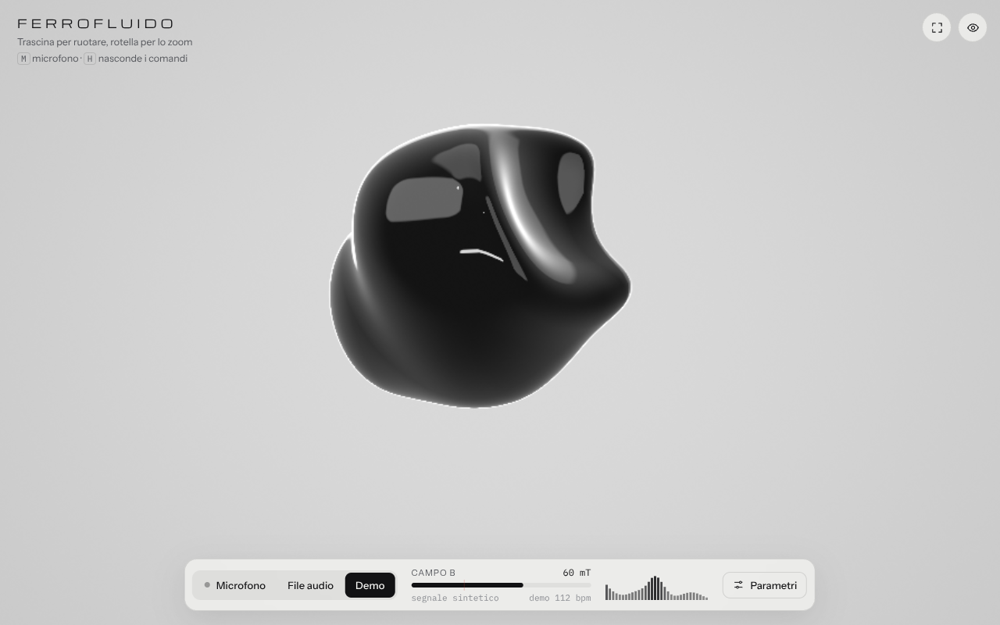
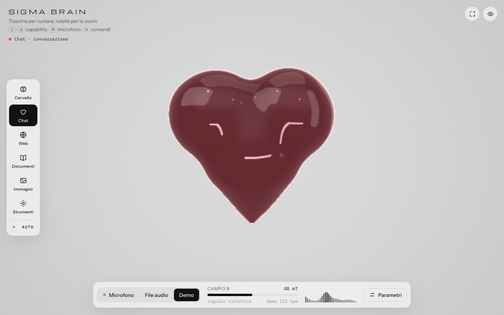
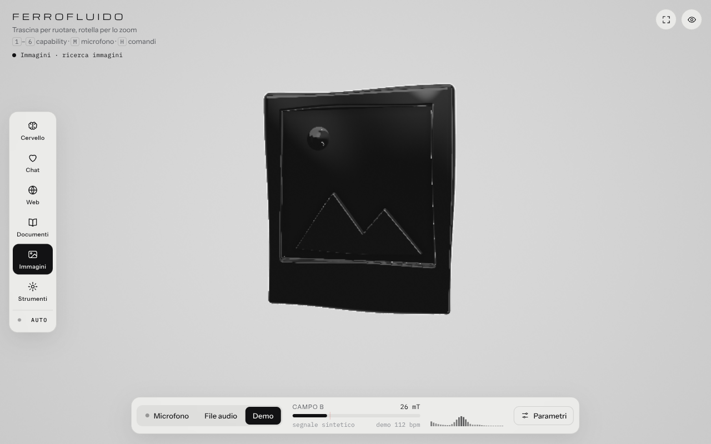
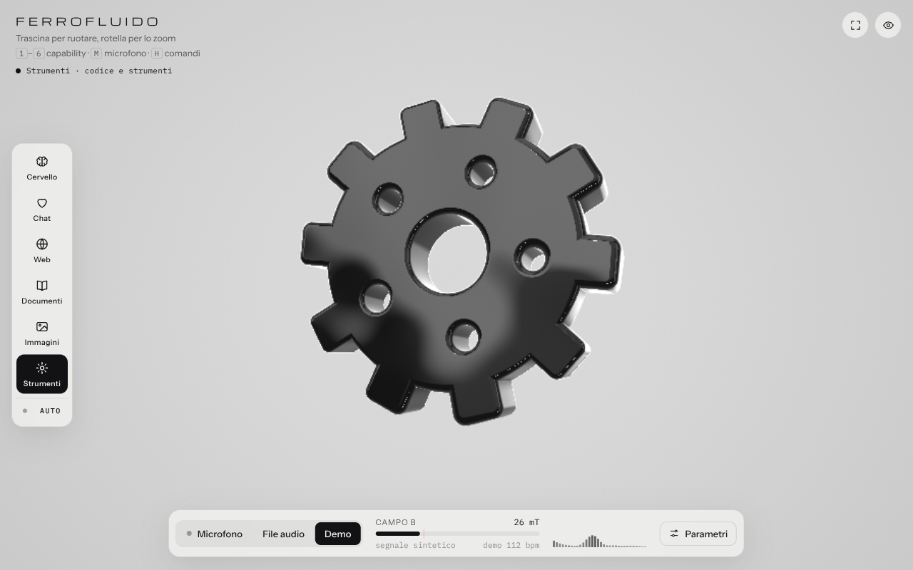
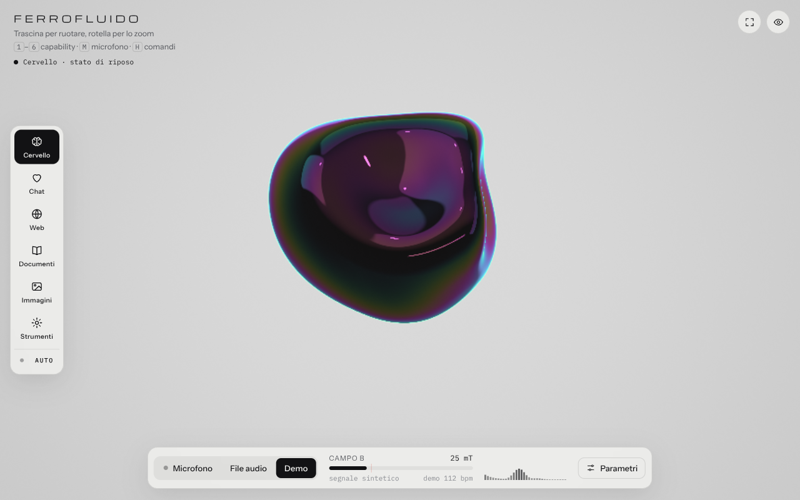

# Sigma Brain

Una massa di ferrofluido nero e lucido, resa in tempo reale nel browser, che si deforma con l'audio del microfono e cambia forma a seconda della *capability* in uso: cuore, pianeta, libro, foto, ingranaggio. Pensata come rappresentazione visiva di un assistente che "pensa" in modi diversi.

Un solo file, `index.html`, senza dipendenze né build: WebGL2 + GLSL (ray marching di campi di distanza), Web Audio API per l'analisi del suono.

| Cervello (riposo) | Chat | Web |
|---|---|---|
|  |  |  |

| Immagini | Strumenti | Iridescenza |
|---|---|---|
|  |  |  |

## Indice

- [Avvio](#avvio)
- [Sorgenti audio](#sorgenti-audio)
- [Capability](#capability)
- [Colore](#colore)
- [Parametri](#parametri)
- [Comandi](#comandi)
- [API JavaScript](#api-javascript)
- [Integrazione in un'app](#integrazione-in-unapp)
- [Come funziona](#come-funziona)
- [Prestazioni e compatibilità](#prestazioni-e-compatibilità)
- [Struttura del progetto](#struttura-del-progetto)

## Avvio

Apri `index.html` in Chrome, Edge, Firefox o Safari. Parte in modalità **Demo** (batteria sintetica a 112 bpm); premi **Microfono** o il tasto `M` e concedi il permesso.

Il microfono richiede un contesto sicuro. Chrome lo accetta anche da `file://`; se il browser rifiuta, servi la cartella in locale:

```bash
python3 -m http.server 8000      # oppure: npx serve .
```

e apri `http://localhost:8000`. Online va pubblicata su `https` (GitHub Pages, Netlify, Vercel: è un file statico).

## Sorgenti audio

| Sorgente | Come |
|---|---|
| Microfono | pulsante **Microfono** o tasto `M`; il browser chiede il permesso |
| File audio | pulsante **File audio**, oppure trascina un mp3/wav/ogg/flac/m4a sulla pagina; `Spazio` mette in pausa |
| Demo | batteria sintetica, attiva all'apertura; tasto `D` |

Il livello è normalizzato con guadagno automatico e sottrazione del rumore di fondo, quindi reagisce sia a una voce sussurrata sia alla musica alta. Il cursore **Sensibilità** lo scala a mano. Il dock mostra il "campo B" (livello normalizzato, 0–96 mT), i dBFS in ingresso e lo spettro a 32 bande.

## Capability

Sei stati, selezionabili dalla barra a sinistra (sul telefono: striscia sotto l'intestazione), con i tasti `1`–`6` o via API. **Auto** (tasto `A`) li alterna ogni 4,5 secondi.

| # | id | Forma | Reazione all'audio | Colore (modalità Capability) |
|---|---|---|---|---|
| 1 | `brain` | massa libera (riposo) | lobi, pieghe e increspature; ruota su sé stessa | grigio ardesia |
| 2 | `chat` | cuore | batte con i bassi | rosso corallo |
| 3 | `web` | pianeta con due anelli | rilievi che ruotano, pulsa con i bassi | blu |
| 4 | `docs` | libro aperto | si apre di più con il volume | ambra |
| 5 | `images` | foto con sole e montagne in rilievo | oscilla lentamente | verde acqua |
| 6 | `tools` | ingranaggio | gira più veloce con il volume | arancio |

La transizione tra due forme dura 1,4 s: il fluido si "scioglie" a metà strada e si ricompone nella forma nuova. Nelle forme il corpo resta vivo (onde e increspature attenuate) e oscilla di ±16° invece di ruotare, così resta rivolto verso chi guarda. Trascinando si ruota comunque a mano; doppio clic riporta la vista al centro.

## Colore

Sorgente della tinta, nel pannello **Parametri → Colore**:

| Sorgente | Comportamento |
|---|---|
| Nero | materiale nero con riflessi bianchi (il riferimento originale) |
| Capability | un colore per stato (tabella sopra); è il default |
| Audio | la tonalità segue il baricentro spettrale (gravi → rosso, medi → giallo/verde, acuti → blu/viola) e l'intensità sale col volume |
| Fisso | il colore scelto nel selettore o passato via API |

**Intensità** regola quanto la tinta entra nel corpo e nei riflessi. **Iridescenza** aggiunge una pellicola sottile che cambia colore con l'angolo di vista; funziona anche in modalità Nero. Il pallino accanto al nome dello stato, in alto a sinistra, mostra il colore corrente.

## Parametri

Pannello **Parametri** (tasto `P`). Tutte le impostazioni restano salvate nel browser; **Ripristina valori** riporta ai default.

**Massa**
- *Dimensione* (50–180%): sincronizzata con rotella e pizzico.
- *Sensibilità* (0,2–3×): guadagno sul livello normalizzato.
- *Deformazione*: quanto i lobi si allontanano dal nucleo nello stato Cervello.
- *Viscosità*: velocità di attacco e rilascio; più alta, più il liquido reagisce e si calma lentamente.
- *Rotazione automatica*: velocità di rotazione dello stato Cervello.

**Instabilità di Rosensweig**
Sopra una soglia critica Bc la superficie di un ferrofluido reale si rompe in punte; qui il "campo" è il livello audio. *Punte magnetiche* è a zero di default (massa liscia); alzalo e regola *Soglia critica Bc*, *Numero di punte* e *Base delle punte*. Le punte sono disposte su un reticolo di Fibonacci sferico e ciascuna risponde a una banda dello spettro.

**Colore**: vedi sopra.

**Studio**: fondale chiaro o scuro; qualità di rendering (*Auto* adatta la risoluzione per tenere 60 fps, *Alta* usa fino a 2× il device pixel ratio).

## Comandi

| Tasto / gesto | Azione |
|---|---|
| trascina | ruota la massa |
| rotella / pizzico | dimensione |
| doppio clic | riporta vista e dimensione ai default |
| `1`–`6` | capability |
| `A` | sequenza automatica delle capability |
| `M` / `D` | microfono / demo |
| `Spazio` | pausa e riproduzione del file audio |
| `P` | pannello parametri |
| `H` | nasconde o mostra i comandi |
| `F` | schermo intero |

## API JavaScript

La pagina espone `window.sigmaBrain` (alias `window.ferrofluido`, mantenuto per compatibilità).

| Membro | Tipo | Descrizione |
|---|---|---|
| `capabilities` | `string[]` | `['brain','chat','web','docs','images','tools']` |
| `capability` | `string` (sola lettura) | stato corrente |
| `progress` | `number` (sola lettura) | avanzamento della transizione di forma, 0..1 (1 = ferma) |
| `setCapability(id)` | `→ boolean` | cambia stato; `false` se l'id non esiste o è già attivo. Spegne Auto |
| `auto(on)` | | attiva o spegne la sequenza automatica |
| `colorModes` | `string[]` | `['none','capability','audio','fixed']` |
| `colorMode` | `string` (sola lettura) | sorgente del colore corrente |
| `setColorMode(mode)` | `→ boolean` | cambia sorgente del colore |
| `setColor('#rrggbb')` | `→ boolean` | imposta un colore fisso e passa alla sorgente `fixed` |
| `setCapabilityColor(id, '#rrggbb')` | `→ boolean` | cambia il colore associato a uno stato (sorgente `capability`) |

Esempi:

```js
sigmaBrain.setCapability('web');          // il fluido diventa un pianeta
sigmaBrain.setColor('#ff0066');           // tinta fissa magenta
sigmaBrain.setColorMode('audio');         // il colore segue il suono
sigmaBrain.setCapabilityColor('chat', '#ff2d95');
sigmaBrain.auto(true);

// attendere la fine di una transizione
const waitIdle = () => new Promise((ok) => {
  const tick = () => (sigmaBrain.progress >= 1 ? ok() : requestAnimationFrame(tick));
  tick();
});
```

**Stato iniziale dall'URL**: `index.html#chat` apre direttamente in quello stato (nessuna transizione).

**Da una pagina che la incorpora in un `<iframe>`** (funziona anche cross-origin):

```js
const w = iframe.contentWindow;
w.postMessage({ type: 'sigmabrain:capability', name: 'docs' }, '*');
w.postMessage({ type: 'sigmabrain:color', color: '#ff0066' }, '*');
w.postMessage({ type: 'sigmabrain:colorMode', mode: 'audio' }, '*');
```

## Integrazione in un'app

Esempio minimo: il fluido in un `<iframe>` e una funzione che lo aggiorna quando l'assistente cambia attività.

```html
<iframe id="brain" src="sigma-brain/index.html#brain"
        allow="microphone" style="width:100%;height:480px;border:0"></iframe>
<script>
  const brain = document.getElementById('brain').contentWindow;
  const STATE = { thinking: 'brain', answering: 'chat', searching: 'web',
                  reading: 'docs', looking: 'images', coding: 'tools' };
  function onAssistantActivity(activity) {
    brain.postMessage({ type: 'sigmabrain:capability', name: STATE[activity] || 'brain' }, '*');
  }
</script>
```

Note:
- l'attributo `allow="microphone"` serve perché l'iframe possa chiedere il permesso; senza, resta disponibile l'audio da file o la demo;
- per nascondere l'interfaccia e lasciare solo il fluido, premi `H` oppure aggiungi la classe `ui-off` a `<body>` dalla pagina stessa;
- il fondale segue il parametro **Studio** (chiaro/scuro); i colori dell'interfaccia sono token CSS in cima al file (`:root` e `body[data-studio="dark"]`).

## Come funziona

- **Forma**: tutto è un campo di distanza con segno (SDF) valutato per pixel in un fragment shader (ray marching, 160 passi max, bounding sphere per saltare il vuoto). Lo stato Cervello è un nucleo più sei lobi che orbitano guidati dalle bande di frequenza, uniti con *smooth minimum*, due sfere sottratte che creano le pieghe, un rumore lento e increspature veloci (acuti) sulla superficie.
- **Capability**: ogni forma è un SDF scritto con primitive classiche (sfere, coni arrotondati, box arrotondati, ripetizione polare per i denti dell'ingranaggio, triangoli estrusi per le montagne). Il passaggio da una forma all'altra è un'interpolazione lineare tra i due campi, che il ray marching attraversa senza problemi perché resta 1-Lipschitz; un picco di rumore a metà transizione dà l'effetto "si scioglie e si ricompone".
- **Punte**: coni su un reticolo di Fibonacci sferico, valutato in forma chiusa (inverse mapping di Keinert et al.), quindi il costo non cresce con il numero di punte.
- **Materiale**: superficie quasi nera con riflessi di Fresnel di un ambiente da studio calcolato analiticamente (tre softbox, una striscia, due punti luce, un pannello frontale), occlusione ambientale a 5 campioni, bordo anti-aliasato per copertura stimata del pixel. La tinta entra nel colore del corpo, in un bordo colorato verso la silhouette e, in parte, nei riflessi; l'iridescenza è una pellicola sottile il cui colore dipende dall'angolo di vista.
- **Audio**: `AnalyserNode` a 2048 campioni; 32 bande logaritmiche da 30 Hz a 14 kHz; RMS con pavimento di rumore adattivo e guadagno automatico; inviluppi con attacco e rilascio separati (la viscosità); baricentro spettrale per la tonalità in modalità Audio.
- **Interfaccia**: HTML/CSS vanilla, token di colore per lo studio chiaro e scuro, layout adattivo fino a 390 px di larghezza, impostazioni in `localStorage`.

Per aggiungere una forma: una funzione `sdNome(vec3 p)` nello shader, un caso in `shapeD()`, una riga in `CAPS` (con `ext`, l'estensione massima della forma, usata per la bounding sphere) e un'icona in `ICONS`.

## Prestazioni e compatibilità

- Richiede WebGL2 (Chrome, Edge, Firefox, Safari 15+). Senza WebGL2 la pagina mostra un avviso.
- In qualità *Auto* il buffer di rendering si adatta tra il 40% e il 100% del device pixel ratio (max 1,5×) per restare sotto i 18 ms per frame; *Alta* forza fino a 2×.
- Il tempo dell'animazione è limitato a 0,1 s per frame: sotto i 10 fps le transizioni e il cambio colore rallentano invece di scattare.
- Su schermi touch: trascina per ruotare, pizzica per la dimensione; la barra delle capability scorre in orizzontale.
- Rispetta `prefers-reduced-motion` (rotazione automatica spenta, animazioni dell'interfaccia disattivate).

## Struttura del progetto

```
sigma-brain/
├── index.html   # tutto: stili, shader GLSL, logica audio e interfaccia
├── README.md
└── docs/        # screenshot usati in questo README
```
